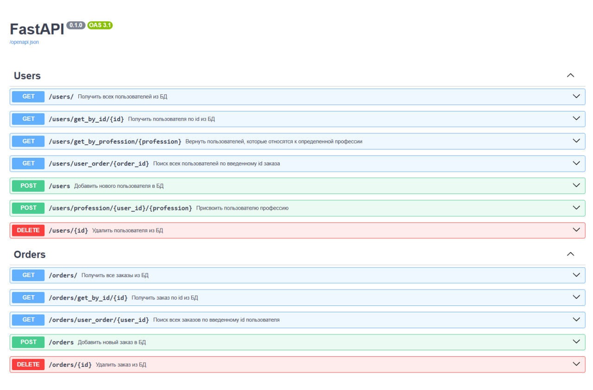

# Проект "Практика разработки Api"

Пет проект, написанный под наблюдением ментора. 
Реализует базовые возможности Fast API. 
Также в проекте присутствует простая архитектура и выстроена иерархия таблиц.

## Скриншоты

### Документация, сгенерированная FastAPI



## Функционал приложения

Работа с пользователями:

- Получения списка всех пользователей
- Получение конкретного пользователя по id 
- Получение пользователей, которые относятся к конкретной профессии
- Поиск пользователей по id заказа
- Добавление нового пользователя
- Присвоение пользователю профессии
- Удаления пользователя

Работа с заказами

- Получения списка всех заказов
- Получение конкретного заказа по id 
- Поиск заказов по id пользователя
- Добавление новго заказа
- Удаление заказа

## Подсчёт очков в теннисном матче

Каждый матч играется по следующим правилам:
- Матч играется до двух сетов (best of 3)
- При счёте 6/6 в сете, играется тай-брейк до 7 очков

## Запуск приложения:

Создайте конфигурационный файл ".env", следуя образцу ".env.example"
Пример .env:
```
DB_HOST="127.0.0.1"
DB_PORT=5432
DB_USER="root"
DB_PASS="password"
DB_NAME="main"
```

Запустите бд postgresql локально или с помощью docker

Инициализируйте бд с помощью alembic:
```
alembic upgrade head
```
Установите необходимые библиотеки и запустите виртуальное окружение
```
python3 -m pip install --upgrade pip && pip install uv
uv venv .venv
uv sync
```
Активируйте venv
```
.\.venv\scripts\activate
```
Запустите Проект:
```
python main.py
```
Теперь можно будет попасть в документацию с по адресу http://127.0.0.1:8000/docs

## Стек технологий

* Python
* FastAPI
* Alembic 
* Pydantic
* PostgreSQL/SQLAlchemy
